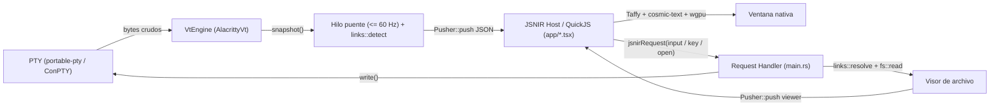

# Arquitectura de icy

`icy` es un workspace **terminal-first y agent-first** escrito en Rust con interfaz nativa en TSX sobre **JSNIR** (`Niiihuel/jsnir`, rama estable `engine`, checkout en `../Jurui`), diseñado para operar múltiples sesiones CLI de agentes (Claude Code, Codex, OpenCode, shells locales) y abrir archivos, diffs o previews web bajo demanda con un click desde cualquier salida de terminal.

---

## 1. Análisis de referencia: cómo está construido `herdr`

Antes de diseñar `icy`, se inspeccionó el código fuente de [`herdr`](https://herdr.dev/) (Apache-2.0):

- **Emulador VT (no usa solo Alacritty):** `herdr` **no** usa `alacritty_terminal`. Usa **`libghostty-vt`** (código Zig vendored bajo `vendor/libghostty-vt` y envuelto en `crates/ghostty-vt`), lo que exige tener Zig 0.16 instalado en local y en CI.
- **PTY:** usa **`portable-pty` 0.9** (vendored y parcheado en `vendor/portable-pty`, con soporte ConPTY en Windows).
- **Arquitectura daemon/cliente:** separa `src/server/` y `src/client/` comunicados mediante `interprocess` (sockets Unix en Linux/macOS y *named pipes* en Windows), enviando deltas de superficie (`src/protocol/surface_delta/`). Las sesiones sobreviven al cierre del cliente.
- **Interfaz:** TUI sobre `ratatui` + `crossterm`.
- **Detección de agentes:** manifiestos declarativos por CLI (`src/detect/manifests/*.toml`) con reglas regex sobre regiones del buffer inferior y título OSC (`AgentState::{Idle, Working, Blocked, Unknown}`), además del protocolo abierto `OSC 7501`.
- **Aislamiento y calidad:** `AGENTS.md` de `herdr` impone separación estricta entre estado puro y runtime, render puro, módulos pequeños, reglas `#[cfg(target_os)]` confinadas a `src/platform/<os>.rs`, API JSON con JSON Schema (`src/api/`) y snapshots persistentes (`src/persist/`).

### Qué adopta `icy` de `herdr` (y qué cambia)

- **Adopta:** la separación estado/runtime, `portable-pty` para PTY cross-platform (ConPTY en Windows desde el día 1), el aislamiento estricto de `#[cfg]` en `platform/`, y la futura arquitectura daemon/cliente + manifiestos de detección de agentes.
- **Cambia:**
  1. En lugar de una TUI en `ratatui`, `icy` usa una **ventana GPU nativa en JSNIR** (TSX compilado con TypeScript 7 sobre QuickJS + Taffy + cosmic-text + wgpu) con el sistema visual de **Accordee** (`DESIGN.md`).
  2. Para no depender de Zig en la Fase 0 ni en CI, `icy` encapsula el emulador VT tras el trait `icy_core::vt::VtEngine` e implementa `AlacrittyVt` sobre `alacritty_terminal` (100% Rust). Si más adelante se necesita `libghostty-vt`, se implementa otro backend para `VtEngine` sin tocar `session.rs` ni `icy-app`.

---

## 2. Arquitectura actual (Fase 0)

El workspace de Cargo se divide en dos crates con responsabilidades desacopladas:

### `crates/icy-core` (sin UI, sin JSNIR)

- `platform/{mod.rs, unix.rs, windows.rs}`: única frontera con `#[cfg(unix)]` / `#[cfg(windows)]`. Resuelve el shell por defecto (`pwsh.exe` si está en `PATH` o `%COMSPEC%` en Windows; `$SHELL` o `/bin/sh` en Unix) y comandos de prueba portables.
- `vt.rs`: trait `VtEngine` (`feed`, `resize`, `snapshot`) e implementación `AlacrittyVt` (`alacritty_terminal 0.26` + `vte::ansi::Processor`). Produce un `Screen` con posición de cursor y segmentos con columna inicial y ancho en celdas, además de los colores y atributos. El puente vence el plazo de redibujados sincronizados (DEC 2026) aunque el programa no envíe más bytes.
- `pty.rs`: wrapper de `portable-pty = "0.9"` (`PtyHandle`) con hilo lector dedicado que notifica nuevos bytes.
- `session.rs`: `Session` une `id`, `title`, `cwd`, `PtyHandle` y `VtEngine` protegido por mutex, con estado `alive`.
- `session_server.rs`: proceso local independiente que es dueño de los PTY y del estado VT. La ventana se conecta con `interprocess` por un socket Unix en un directorio privado o un named pipe de Windows restringido a la cuenta. El cliente envía entrada, resize y selección, y recibe avisos de cambios para solicitar las pantallas. Al desconectar la ventana, el servidor sigue leyendo cada PTY y conserva su scrollback y sus imágenes en memoria.
- `git.rs`: cambios del working tree (`git status --porcelain -z` + `git diff HEAD --numstat`) y diffs unificados numerados, con parsers puros testeados; alimenta Review y los puntos VCS del árbol.
- `syntax.rs`: tokenizador por línea (keyword, string, comment, number, type, function) para el visor de código y el diff.
- `tiling.rs`: motor estilo niri/Hyprland. Niri: strip horizontal infinito con anchos por columna en fracciones del viewport (presets 1/3·1/2·2/3, ±10%, maximize-column), desplazamiento mínimo para mantener visible la columna enfocada, center/move/consume-or-expel. Hyprland: las columnas comparten el ancho (suman 1) y el resize mueve el borde con la vecina (`resizeactive`). Las alturas de paneles son fracciones por columna. Cada pane recibe su propio tamaño de PTY. Focus es un estado de cada workspace y se aplica a su pane enfocado. Niri guarda por columna el ancho previo a Expand column para restaurarlo al volver a elegir la acción.
- `session.rs` / `platform::foreground_cmdline`: el proceso en primer plano identifica la CLI en Linux (`process_group_leader` + `/proc/<pid>/cmdline`). Si no está disponible, se usa el comando lanzado desde icy, la identificación OSC o el título. `agent_status.rs` negocia `OSC 7501` y toma el estado principal reportado por la CLI. Versiones sin ese protocolo recurren al estado de progreso, a indicadores del título o al pie de la pantalla viva, sin consultar el historial del scroll. `Sessions` distingue listas para recibir entrada, trabajo, entrada pendiente, fin y error; el puente solo publica cambios.
- `graphics.rs`: protocolo gráfico de Kitty (lo que usa Codex para previsualizar imágenes): separa los APC `ESC _ G … ESC \` del flujo del PTY antes del VT, responde la consulta `a=q`, guarda PNG/RGB(A) (directo en trozos o por ruta de archivo) y los ancla a la celda del cursor en línea absoluta para que acompañen el scroll; `a=p` / `a=d` recolocan y borran. Los redibujos idénticos reutilizan la textura (hash). Sin compresión `o=z`, memoria compartida ni placeholders unicode.
  Al recibir un APC durante un redibujado sincronizado, el VT aplica los movimientos de cursor pendientes antes de resolver la posición de la imagen y vuelve a acumular la salida hasta el cierre del redibujado.
- `keybinds.rs`: atajos editables — catálogo de acciones con defaults, parseo/formato de combinaciones, overrides de la config y resolución de conflictos; `window.rs` arma la combinación de cada tecla (sin modificadores, protegiendo AltGr) y la resuelve contra el keymap vigente.
- `links.rs` detecta rutas de archivos, ubicaciones, encabezados de ediciones de agentes y URLs. El host resuelve las rutas desde el `cwd` de la sesión. Cuando el CLI imprime una vista previa numerada, la primera fila agregada o eliminada indica dónde enfocar el diff.

### `crates/icy-app` (ventana JSNIR + TSX)

- `build.rs` + `app_bundle.rs`: empaqueta `../Jurui/app/sdk.ts` + los módulos de `icy/app/*.tsx` usando el compilador nativo TypeScript 7 (`JSNIR_TSC` → `../Jurui/target/typescript/lib/tsc` → `../Jurui/node_modules/@typescript/typescript-<os>-<arch>/lib/tsc[.exe]`), limpiando prefijos UNC `\\?\` en Windows.
- `src/main.rs`:
  - Carga las fuentes embebidas (`Inter-Regular`, `Inter-Medium`, `Inter-SemiBold`, `GeistMono-Regular`, `GeistMono-SemiBold`) en `Host` y fija `"Inter"` como familia por defecto.
  - Atiende pedidos síncronos desde TSX vía `Host::with_request_handler`: `hello`, `input`, `key` (`ctrl-c`, `esc`, `tab`, `up`, `down`), `open`, `closeViewer`, `resize`, `newSession`, `selectSession`.
  - El hilo `icy-ui-bridge` agrupa la salida de los PTY en actualizaciones separadas por al menos `16 ms`. Cada `terminalFrame` incluye las filas que cambiaron y reutiliza la pantalla visible para la terminal de contexto. La UI confirma cada actualización antes de que el puente envíe el siguiente delta.
  - Soporta `--offscreen <archivo.ppm>` mediante `jsnir_gpu::capture_at` para smoke tests en CI.
- `src/window.rs` usa `jsnir_gpu::view::View` para compartir el atlas persistente de texturas y agrupar dibujos con el mismo recorte.
- `app/`: UI en TSX compilada a un único `app.js` embebido (`theme.ts`, `ui.tsx`, `updater.tsx`, `tabs.tsx`, `sidebar.tsx`, `terminal.tsx`, `tiling.tsx`, `panel.tsx`, `palette.tsx`, `settings.tsx`, `metrics-data.ts`, `sections.tsx`, `main.tsx`). `panel.tsx` contiene Files, Review, Overview, Metrics, Archived, archivo y diff y su card en el tiling (`TilePane`). `palette.tsx` contiene la paleta modal compartida por el launcher y la búsqueda de sesiones.

  **Ventanas del compositor.** No hay panel lateral: cada ventana es un pane del mismo `TilingWorkspace` que las terminales. El host solo reparte ids (`openTile`, mismo contador que las sesiones) y los guarda en `tiles`; `closeSession`, `selectSession`, `Ctrl+Tab` (`pane_order`) y el foco tratan igual ambos tipos, y la entrada de teclado solo va al PTY si la ventana enfocada es una terminal (`focused_terminal`). Qué muestra cada id (`TileSpec`) vive en `ui.tsx` (`tileSpecs`); los archivos y diffs llegan por el push `viewer` a una caché por `kind:path` (`docCache`). Una ventana pedida por sí misma no se re-enruta (`silentDocs`); un archivo abierto desde la terminal se ubica con `openDocTile`. Arrastrar una ventana (header o pestaña) calcula el destino en `tiling.tsx` (`computeDrop`, con la misma geometría que pinta las columnas) y lo envía como `moveWindow` → `TilingWorkspace::move_pane(id, DropTarget::NewColumn(i) | Into { col, row })`, que conserva el ancho de una columna que se mueve entera y reparte el alto al apilar.

  **Workspaces (niri).** `icy-core::tiling::Workspaces` es una lista vertical de `TilingWorkspace` con uno activo y reglas de niri (`tidy`): siempre un workspace vacío al final y los vacíos intermedios se descartan al salir de ellos. Implementa `Deref`/`DerefMut` hacia el activo, así todas las operaciones de una ventana (`open_column`, `move_pane`, resize, foco direccional) actúan sobre el workspace visible sin cambiar el host; las que necesitan ver todos (`focus_session` activa el workspace que contiene la ventana, `remove_session`, `set_mode`, `snapshot` con `workspaces`/`activeWorkspace`) están definidas en `Workspaces` y tienen prioridad. El host expone `focusWorkspace {index}` y `moveToWorkspace {id, index, insert}` y las acciones `workspace.down/up/moveDown/moveUp`. En la UI, `tileSpecs` se poda con las ventanas de **todos** los workspaces (`allWindowIds`), para no perder el tipo de una ventana que está en otro. `tiling.tsx` dibuja **todos** los workspaces vivos, apilados en vertical con el hueco de niri (10 % del alto, `workspace_gap` de `monitor.rs`), cada uno en su `WorkspaceLayer` al tamaño del área. Cambiar de workspace anima solo la `y` de la pila; el Overview es la misma pila con `scale` 0.5 alrededor del workspace centrado (JSNIR escala respecto del centro de la caja, igual que el zoom de niri respecto del centro de la salida). No hay miniaturas ni fundidos: cada ventana existe una sola vez. Con el Overview abierto el host transmite las pantallas de todas las sesiones (`visible_terminals`); fuera de él, los panes de otros workspaces conservan su último frame.
- Archived es otra ventana global del compositor. El host guarda en memoria las sesiones cerradas (título, CLI, carpeta y hora de cierre; como máximo 200, la más reciente primero) y las publica en `sessions.archived`. Desde la lista se abre una sesión nueva en la misma carpeta y con el mismo CLI, o se quita una entrada (`forgetArchived`, sin `id` vacía la lista). El archivo se pierde al cerrar icy.
- **Review y documentos sin bloquear QuickJS.** `open` / `openDiff` resuelven el contexto y delegan IO, Git y tokenización a un hilo `icy-document`, sin retener el mutex del gestor. La respuesta llega por `PushViewer`; una generación descarta navegaciones anteriores si se pidió otro documento en primer plano mientras cargaban. Los pedidos de ventanas ya abiertas (`background`) solo actualizan su caché. Los archivos nuevos se convierten directamente en líneas agregadas, sin un segundo proceso Git ni rutas de dispositivo nulo; los diffs deshabilitan herramientas externas y textconv. Review coalesca consultas en curso por proyecto, conserva los objetos de archivos sin cambios y no publica una actualización reactiva si el resultado es idéntico.
- **Virtualización en la aplicación.** `LazyRows` mantiene la fuente aparte del viewport. Calcula el rango visible por altura fija en Files y Review, y por búsqueda binaria sobre un índice de alturas en el editor. El índice solo cambia cuando cambia el número efectivo de columnas o el contenido. El visor limita el resaltado por tamaño de archivo y línea, y recorta visualmente las filas extremas sin perder el texto original para copiarlo.
- **Edición y contexto.** La edición explícita usa `TextInput` de JSNIR para el cursor, selección, IME y deshacer; los borradores sucios sobreviven al cierre del panel durante la sesión. El guardado comprueba que el archivo no haya cambiado y reemplaza el original de forma atómica, conservando BOM, CRLF y permisos. Como `TextInput` normaliza tabulaciones y otros caracteres de control, estos archivos y los de más de 64 KiB no se editan en línea. Las muestras TTF/OTF se rasterizan con un `TextEngine` aislado y no modifican la caché de fuentes global. El menú de contexto sigue el patrón de Herdr de apuntar a una sesión concreta, pero solo pega en modo bracketed paste y deja el envío al usuario.
- **Árbol de archivos.** `listFiles` lee cada carpeta en segundo plano. La interfaz agrupa pedidos en curso por proyecto y carpeta, reutiliza las entradas que siguen iguales y aísla la selección de los datos que aplanan el árbol. El índice de cambios de Git permite consultar los indicadores VCS de archivos y carpetas sin recorrer la lista por cada fila.
- Scroll del terminal: la rueda vertical sobre una grilla va a la sesión que está debajo del puntero, esté enfocada o no, y nunca al tiling. `icy-core::vt::wheel_input` decide como xterm: si el programa pidió reportes de mouse (1000/1002/1003) recibe eventos de rueda en SGR (1006) o X10 en la celda señalada; en la pantalla alternativa con *alternate scroll* (1007) recibe flechas; si no, la vista recorre el historial (5000 líneas) y la salida nueva no la mueve. Escribir vuelve al final, igual que la barra "Jump to latest". Cada muesca son 3 líneas; el touchpad acumula píxeles por alto de celda.
- Metrics es una ventana más del compositor (`TileKind` `"metrics"`): tiene pestaña, entra en el tiling, admite fullscreen y overview, y hay una sola para todos los proyectos. Se maqueta con su ancho medido, no con el de la ventana. Pide un escaneo local al abrirse por primera vez y al pulsar Refresh. Un hilo dedicado ejecuta `icy-core::usage` y el puente publica agregados diarios, por hora y por modelo en UTC. Los registros compatibles incluyen Claude Code, Codex, Antigravity, Grok CLI y OpenCode. OpenCode guarda su historial en SQLite (`$XDG_DATA_HOME/opencode/opencode.db`, por defecto `~/.local/share`); se abre en solo lectura con `rusqlite` (SQLite embebido, igual en Linux y Windows) y los campos se extraen con `json_extract` para no leer el cuerpo de los mensajes. En OpenCode un turno va de un mensaje del usuario al último paso del asistente antes del siguiente. Junie todavía no tiene lector: su formato local no está verificado. JSNIR aplica los períodos y el filtro por agente sobre el agregado. Las duraciones se suman por turno completado y se asignan al día de finalización.

### Flujo de datos

---

## 3. Pipeline de archivos clickeables (capas progresivas)

Para que cualquier CLI funcione sin integraciones propietarias, `icy` combina cuatro capas ordenadas de mayor heurística a mayor certeza:

1. **Detección léxica por línea (`icy_core::links::detect`, activo en Fase 0):** escanea cada fila visible buscando URLs y rutas con o sin `:línea:columna` o `(línea,columna)` y las resuelve contra el `cwd` del pane (`resolve`). Solo las rutas verificadas o URLs se marcan como enlaces activos.
2. **Hipervínculos `OSC 8` (próximo paso):** `alacritty_terminal` ya almacena `Hyperlink` en `CellExtra`; herramientas modernas (`rg --hyperlink-format`, `ls --hyperlink`, `delta`) emiten rutas exactas aunque el texto visual esté truncado.
3. **Watcher del filesystem por sesión (`notify`, Fase 2):** registra archivos creados o modificados mientras cada pane está activo, permitiendo listar los archivos tocados por cada agente con su diff contra `git` aunque la CLI no imprima la ruta completa.
4. **Hooks y transcripts de agentes (Fase 3):** integración con hooks (p. ej. `PostToolUse` en Claude Code) y transcripts JSONL para atribuir exactamente qué agente editó cada archivo y saltar al diff exacto.

---

## 4. Evolución planificada (inspirada en `herdr` y Cursor)

- **Recuperación tras reiniciar el servidor:** persistir el layout en disco y registrar los identificadores nativos que reporten los agentes para que los CLI compatibles puedan reanudar su conversación. Herdr usa estas referencias para la restauración en frío. T3 Code conserva una referencia al hilo del proveedor y la usa al reconstruir el runtime. [Restauración en Herdr](https://herdr.dev/tui/docs/session-state/) [Restauración en T3 Code](https://github.com/pingdotgg/t3code/blob/main/docs/user/updating.md)
- **Detección de estado de agentes:** incorporar manifiestos TOML al estilo `herdr` (`Idle` / `Working` / `Blocked`) + `OSC 7501` y tracking de `cwd` vía `OSC 7`.
- **To-dos por sesión:** extraer listas de tareas directamente de los hooks/transcripts de agentes y mostrarlas sincronizadas junto al pane.
- **Editor de código dedicado en JSNIR:** ampliar la edición nativa con tabs sin normalización, resaltado durante la escritura y virtualización del buffer editable.
- **Métricas de agentes (Fase 5):** lector de logs JSONL (`~/.claude/projects`, Codex, OpenCode, etc.) para poblar tarjetas KPI (tokens input/output, tareas, tiempo activo), barras diarias, heatmap semanal por hora y ranking por modelo/agente.

---

## 5. Limitaciones / Gaps actuales del motor JSNIR (ver `jsnir-ref.txt`)

Durante el diseño se verificó el contrato real en `Jurui/app/jsnir.d.ts` y `Jurui/backends/gpu/src/app.rs`. Estas limitaciones de JSNIR condicionan las fases futuras (no se modifica `Jurui` en esta etapa):

1. **Sin eventos crudos de teclado en TSX:** `app/jsnir.d.ts` solo expone eventos de `input` (`onSubmit`, `onChange`) y `backends/gpu/src/app.rs` únicamente reenvía `Escape` cuando no hay foco en un campo. Falta `onKeyDown` en `Box` para enviar teclas crudas (`Ctrl+C`, `Tab`, flechas, atajos) directamente al PTY sin depender del composer ni de botones.
2. **Una sola ventana por proceso (`open_with`):** la API actual de `jsnir-gpu` abre una única ventana. Abrir editores o previews en ventanas flotantes separadas requiere soporte multi-ventana en `AppWindow`.
3. **Sin embedding de WebView (`wry`):** no existe un tipo de nodo o handle de superficie hija para incrustar WebView2/WebKitGTK dentro de un layout JSNIR.
4. **Grilla de terminal por celdas:** JSNIR posiciona los segmentos por las columnas que proporciona el VT, no por el avance del texto compuesto. Fondo, cursor y selección comparten la misma geometría. La PTY recibe las filas y columnas que entran en la grilla medida tras el layout; la estimación del host solo sirve antes de medir. Para TUIs de frecuencia muy alta, queda evaluar rasterizar la grilla directamente en Rust.
5. **Spans individuales sin `onPress`:** `Span` en `app/jsnir.d.ts` no admite callback propio; hoy la fila (`Box`) dispara el primer enlace detectado y una barra auxiliar expone los chips individuales. Se requieren hitboxes/callbacks por span dentro de `Text`.

6. **Eventos de arrastre (resuelto en `c2509f9`):** `Box.onDrag` (`start`/`move`/`end` con `dx`/`dy`) y `paint.cursor` (`colResize`, `rowResize`, …) permiten redimensionar columnas y panes arrastrando el borde entre ellos (`icy-core::tiling::resize_column` / `resize_pane`). `jsnir-ref.txt` ya apunta a ese commit; el CI lo necesita publicado en `Niiihuel/jsnir`.
7. Un nodo `scroll` de JSNIR desplaza en vertical. Las pestañas y la fila de CLIs comparten `HorizontalStrip`, que recorta una fila trasladada sobre el eje X. Las flechas ocupan su propio espacio al lado del área recortada cuando hay desborde. La ventana reenvía los deltas horizontales y Shift + rueda a la tira bajo el puntero. El editor sigue envolviendo las líneas largas con `LazyRows`.
8. **Reciclado de ids en un mismo batch (bug, reportar en Jurui):** si un batch quita un subárbol (p. ej. una card que se va a otra fila de un `For`) y en el mismo flush se monta otro nodo que reutiliza un id de ese subárbol antes de que su `Remove` se aplique, el validador expande el `Remove` sobre el árbol viejo y descarta también el nodo nuevo; el siguiente hijo cae en `invalid_parent` y la UI rechaza el batch entero (la vista queda congelada). Se reprodujo en el Overview al soltar una ventana en otro workspace, con el `Show` del texto "Empty workspace". Mitigación en icy: ese texto queda siempre montado y se muestra por opacidad. Reproducible también contra `c2509f9`; la traza `DBGBAD` de `lib.rs` apunta a una operación equivocada porque compara contra el estado previo al batch.
9. **Animaciones de salida (resuelto en `3d61359`):** `paint.exiting` congela el último frame del subárbol al quitarlo y lo anima con sus `transitions`. En `tiling.tsx`, cada pane declara su salida antes de que el push de tiling lo quite (`tilingExit`, en el mismo batch): una ventana cerrada se desvanece y se achica en su lugar. Un cambio de workspace no usa salidas: mueve la pila de workspaces entera (ver **Workspaces (niri)**). Las ventanas que siguen abiertas en otra columna o workspace se van sin animación. El motor solo congela el último frame de los nodos que ya tenían `exiting` al dibujarse, así que todo pane abierto lleva un `exiting` vacío (`{}`, no anima nada) y el cierre lo reemplaza en el mismo batch; con `undefined` no hay frame que animar y la ventana desaparece de golpe. Ya no existen las cards vacías (`closingWindows`).
10. **Sin evento de rueda en TSX:** la rueda solo mueve las cajas `scroll`. El scroll del terminal va por el host: el pane registra su grilla bajo el puntero (`terminalWheel`: sesión, origen, tamaño de celda y fila señalada) y `window.rs` manda la rueda vertical a esa sesión antes que a JSNIR. La fila la informa el pane porque los panes apilados se ubican con `paint.y`, que `jsnir.columns.y` no incluye.

9. JSNIR puede reutilizar el ID de un callback si una vista se desmonta antes de que se ejecute su temporizador. `afterView` conserva el callback en un alcance independiente hasta que vence el temporizador y verifica que su vista siga montada.
10. **Medición de filas de código:** el contrato fijado no expone `onResize` / `onLayout` a TSX. `LazyRows` consulta las columnas compartidas tras cambios de viewport/tiling con temporizadores coalescados y usa alturas estimadas para líneas envueltas, no alturas exactas de texto. Por eso archivos con líneas largas pueden presentar deriva en el espaciador; una virtualización con medidas exactas o integrada con `VirtualList` requeriría otro contrato de datos/medición. El payload de un documento sigue llegando completo hasta el límite de líneas: la virtualización reduce nodos vivos, no el costo de serializar o transferir ese payload. No se modificó `../Jurui` ni su pin para estas optimizaciones.
11. **`radius` animable (resuelto en `3d61359`):** `paneCardPaint` declara `springTransition("radius")`, así que al entrar o salir de fullscreen las esquinas pasan de `radii.popover` a `0` con el mismo resorte que el layout.
12. **Coalescencia de `push` (resuelto en `3d61359`):** `Host::push_keyed` reemplaza en el `backlog` un mensaje pendiente con la misma clave. `window.rs` lo usa vía `Pusher::push_keyed` para `screen`, `screens` y `sessions`; los demás `push` siguen en orden FIFO.
13. **Selección nativa de campos en edición:** el color de selección de un `TextInput` multilínea está fijado en `src/host.rs` de Jurui (`Item::Editor { selection: [70,120,220,110] }`); `paint.highlight` no lo cambia. icy lo deja en el valor por defecto del motor (el token `selection` del tema coincide con `0x4678dc6e`). Hasta que el motor lo exponga, el tema no lo personaliza en modo edición.
14. **Campos sin evento de selección ni geometría del cursor:** `Field` expone `text()`, `selection()` y `rect()`, pero no notifica cambios. `SourceEditor` consulta `Field.selection()` cada `caretPollMs` para el pie (`Ln`, `Col`) y ubicar el chip "Add to Chat".
15. **Fondos de span redondeados por span:** `Span.backgroundRadius` redondea cada fragmento por separado; la selección de texto en vista previa se dibuja así, con una pieza por span y línea visual. En líneas envueltas la selección por columna es aproximada (`columnAt` en `app/panel.tsx`).
16. **Resortes de duración fija y sin velocidad:** `Easing::Spring` (`src/motion.rs`) es una curva muestreada de 560 ms con 8 % de rebote, y una transición reorientada a mitad de camino arranca desde el valor en pantalla con velocidad cero. icy reemplazó ese resorte por la curva críticamente amortiguada de niri ajustada como `cubic-bezier` (`niriMotion` en `app/theme.ts`: 326 ms a rigidez 800, 291 ms a 1000, error máximo 2 %, sin rebote). Para igualar a niri en gestos (que conservan la velocidad al soltar) el motor necesitaría transiciones físicas con `stiffness`/`damping` y velocidad inicial.
17. **Sin detección de cambios en el host:** `Host` no indica si `poll()` recibió un batch ni expone `PartialEq` en `Frame`. Mientras hay temporizadores pendientes (`afterView` periódicos como el sondeo del cursor del editor o el fondo ASCII), `host.busy()` sigue en `true` y `window.rs` pide un redibujado completo cada 4 ms aunque la escena no haya cambiado. Con `PresentMode::Fifo` eso renderiza al refresco del monitor sin necesidad. Haría falta que el motor exponga una versión o un flag de “sucio”. Para medir el ciclo real: `ICY_FRAME_STATS=1 icy` imprime cada segundo los fps y el tiempo promedio y máximo de `poll`, `acquire` (espera de vsync), `layout`, `draws` y `gpu`.
18. **Sin captura viva ni escala no uniforme:** niri anima un resize o la entrada a fullscreen con una captura del contenido viejo y el nuevo, ambos estirados al tamaño intermedio y fundidos (`tile.rs`, `ResizeAnimation`). En JSNIR `Paint.scale` es uniforme y solo `paint.exiting` congela un frame, al quitar el nodo. icy redimensiona el PTY al empezar el fullscreen (el programa redibuja durante el resorte) y recorta el contenido con la caja que se anima. Para igualar a niri el motor necesitaría escalas `scaleX`/`scaleY` y una captura de un subárbol vivo que pueda fundirse con su contenido nuevo.

---

## 6. Notas específicas de Windows

- **PTY:** `portable-pty` utiliza **ConPTY** nativo en Windows 10/11 (`x86_64-pc-windows-msvc`). El shell por defecto prioriza `pwsh.exe` si existe en `PATH`, con fallback a `%COMSPEC%`.
- **Rutas y enlaces:** `links.rs` distingue letras de unidad (`C:\ruta\archivo.rs:12:3` y `C:/ruta/archivo.ts`) de separadores `:línea:columna`.
- **GPU / DirectX 12:** `jsnir-gpu` habilita solo `gles` y `vulkan` en `wgpu = "30.0.1"`, pero crea la instancia con `Backends::PRIMARY`. `crates/icy-app/Cargo.toml` activa el feature `dx12` en `[target.'cfg(windows)'.dependencies]` aprovechando la unificación de features de Cargo sin tocar `Jurui`.
- **Subsistema GUI:** `main.rs` declara `#![cfg_attr(all(windows, not(debug_assertions)), windows_subsystem = "windows")]` para evitar consola extra en builds release.
- **Compilador TS 7 en Windows:** se invoca el binario nativo `@typescript/typescript-win32-x64/lib/tsc.exe` (evitando el shim `.cmd` de `node_modules/.bin/tsc`) y `app_bundle.rs` elimina prefijos extendidos `\\?\` de `canonicalize()` antes de escribir `tsconfig.json`.

---

## 6.1 Navegador integrado (CEF offscreen)

**Por qué OSR.** Un navegador en un tile del tiling no puede ser un WebView hijo: `wry` no funciona con ventanas hijas en Wayland bajo winit, y un overlay nativo rompería el z-order de icy. La paleta y los menús se dibujan encima de los tiles, y un overlay no se recorta con las columnas parciales de niri ni con las miniaturas del overview. Con CEF en modo *windowless* la página es solo un frame RGBA, así que icy la pinta como cualquier imagen (`Pusher::browser_frame`) y obedece al mismo layout, recorte y overview que las terminales.

**Flujo.**

1. `BrowserView` (`app/browser.tsx`) mide su cuerpo con `jsnir.columns` y envía una petición `browser` con la operación.
2. `handle_request` (`crates/icy-app/src/main.rs`) la traduce a `browser::Command` y la envía por el puente (`BridgeEvent::Browser`).
3. `run_bridge` la reenvía con `Pusher::browser` al hilo principal (`user_event` en `window.rs`), donde vive CEF.
4. `Browsers` (`crates/icy-app/src/browser.rs`) aplica el comando. CEF entrega un frame BGRA; `on_paint` lo convierte a RGBA y lo publica como imagen `browser:<id>`.
5. El `<Image source="browser:<id>">` del tile la muestra. Dirección, título, carga y errores vuelven a TSX como `browserState`.

El id del navegador es el id del tile. Varios tiles de navegador conviven como terminales: se mueven, redimensionan, apilan y aparecen en el overview.

El sidebar, la paleta y los enlaces de la terminal usan `openBrowser`. Al pasar el cursor por un enlace local, la tarjeta carga una vista CEF con un id separado, que se retira al cambiar de dirección o después de quedar oculta. La tarjeta de una URL pública muestra su dirección y la página carga al abrir el pane.

**Contrato.**

- Peticiones `{type: "browser", op, id, ...}`:
  - `open` (`url`, `width`, `height`): crea el navegador o, si ya existe, lo vuelve a mostrar.
  - `navigate` (`text`), `back`, `forward`, `reload`, `resize` (`width`, `height`), `hidden` (`hidden`), `close`, `focus`.
  - `pointer` (`node`, o `id: 0` con `from` al salir del cuerpo): alimenta el hit-test de puntero de `window.rs`.
  - La rueda, el clic y el teclado no pasan por peticiones: `window.rs` los envía al navegador enfocado o bajo el puntero.
- Petición síncrona `browserAddress` (`text`, `search`) → `{url}`: normaliza lo que escribe el usuario con `icy_core::browser::normalize_url` o `address_url`.
- Vista `browserState` → `{id, url, title, loading, canBack, canForward, error}`. El título de la barra y el error de la tile salen de aquí.

**Runtime de CEF.** Se busca en `CEF_PATH`; si no está definido, en la carpeta del ejecutable. Debe contener `icudtl.dat`, `locales/` y los `.pak`. Si falta, la tile muestra «Browser runtime not found» sin iniciar CEF, porque CEF aborta el proceso cuando faltan recursos. En el build, `cef-dll-sys` lee la misma variable y valida el `archive.json` del directorio exportado con `export-cef-dir`.

**Subprocesos.** CEF vuelve a ejecutar icy para sus procesos auxiliares (`--type=renderer`, …). `main()` llama primero a `browser::run_subprocess()` y termina antes de parsear argumentos, porque `main()` rechaza los desconocidos.

**Arranque perezoso.** CEF no se inicializa hasta el primer `open`. Al cerrar icy, `shutdown` cierra los navegadores y espera hasta 2 s a que terminen.

**Perfil.** Cookies y caché viven en `<config>/browser`; en Linux, `~/.config/icy/browser`.

**Límites conocidos.**

- Copia de frame por CPU en cada pintado (BGRA → RGBA): páginas con vídeo o a 60 fps consumen CPU. Mejora posible: OSR acelerado con texturas compartidas.
- Sin composición IME: la entrada CJK no se compone dentro de la página. El pegado sí funciona (`insert_text`).
- Sin DevTools, sin menú contextual y solo clic izquierdo.
- Sin sandbox (`no_sandbox`) y bombeo de mensajes fijo a 16 ms mientras hay navegadores abiertos.

---

## 7. Roadmap por fases

| Fase | Alcance |
| --- | --- |
| **Fase 0 (actual)** | Workspace `icy-core` + `icy-app`, PTY (`portable-pty`), VT (`alacritty_terminal`), `links.rs`, shell TSX con diseño Accordee, visor read-only al clickear archivos, CI verde en Linux + Windows. |
| **Fase 1** | Reconexión de terminales vivas por `interprocess` y `OSC 8`. Quedan la recuperación tras reiniciar el servidor y el tracking de `cwd` por `OSC 7`. |
| **Fase 2** | Watcher `notify` por sesión, panel de archivos tocados + diff contra `git`, editor nativo editable en JSNIR (y apertura de spans exactos). |
| **Fase 3** | Detección de estado de agentes por manifiestos (`Idle`/`Working`/`Blocked`), `OSC 7501`, extracción de to-dos desde hooks/transcripts. |
| **Fase 4** | Navegador CEF en el tiling y vista previa de enlaces HTTP y HTTPS desde la terminal. |
| **Fase 5** | Dashboard de métricas leyendo JSONL de agentes (KPIs, tokens diarios, heatmap horario, uso por modelo/CLI). |
