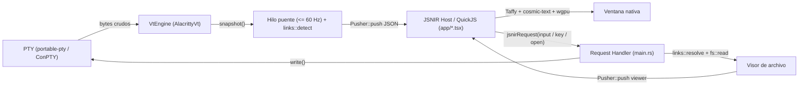

# Arquitectura de icy

`icy` es un workspace **terminal-first y agent-first** escrito en Rust con interfaz nativa en TSX sobre **JSNIR** (`../Jurui`), diseñado para operar múltiples sesiones CLI de agentes (Claude Code, Codex, OpenCode, shells locales) y abrir archivos, diffs o previews web bajo demanda con un click desde cualquier salida de terminal.

---

## 1. Análisis de referencia: cómo está construido `herdr`

Antes de diseñar `icy`, se inspeccionó el código fuente de [`herdr`](https://herdr.dev/) (Apache-2.0):

- **Emulador VT (no usa solo Alacritty):** `herdr` **no** usa `alacritty_terminal`. Usa **`libghostty-vt`** (código Zig vendored bajo `vendor/libghostty-vt` y envuelto en `crates/ghostty-vt`), lo que exige tener Zig 0.16 instalado en local y en CI.
- **PTY:** usa **`portable-pty` 0.9** (vendored y parcheado en `vendor/portable-pty`, con soporte ConPTY en Windows).
- **Arquitectura daemon/cliente:** separa `src/server/` y `src/client/` comunicados mediante `interprocess` (sockets Unix en Linux/macOS y *named pipes* en Windows), enviando deltas de superficie (`src/protocol/surface_delta/`). Las sesiones sobreviven al cierre del cliente.
- **Interfaz:** TUI sobre `ratatui` + `crossterm`.
- **Detección de agentes:** manifiestos declarativos por CLI (`src/detect/manifests/*.toml`) con reglas regex sobre regiones del buffer inferior y título OSC (`AgentState::{Idle, Working, Blocked, Unknown}`), además del protocolo abierto `OSC 7501`.
- **Aislamiento y calidad:** `AGENTS.md` de `herdr` impone separación estricta entre estado puro y runtime, render puro, módulos pequeños, reglas `#[cfg(target_os)]` confinadas a `src/platform/<os>.rs`, API JSON con JSON Schema (`src/api/`) y snapshots persistentes (`src/persist/`).

### Qué adopta `icy` de `herdr` (y qué cambia)

- **Adopta:** la separación estado/runtime, `portable-pty` para PTY cross-platform (ConPTY en Windows desde el día 1), el aislamiento estricto de `#[cfg]` en `platform/`, y la futura arquitectura daemon/cliente + manifiestos de detección de agentes.
- **Cambia:**
  1. En lugar de una TUI en `ratatui`, `icy` usa una **ventana GPU nativa en JSNIR** (TSX compilado con TypeScript 7 sobre QuickJS + Taffy + cosmic-text + wgpu) con el sistema visual de **Accordee** (`DESIGN.md`).
  2. Para no depender de Zig en la Fase 0 ni en CI, `icy` encapsula el emulador VT tras el trait `icy_core::vt::VtEngine` e implementa `AlacrittyVt` sobre `alacritty_terminal` (100% Rust). Si más adelante se necesita `libghostty-vt`, se implementa otro backend para `VtEngine` sin tocar `session.rs` ni `icy-app`.

---

## 2. Arquitectura actual (Fase 0)

El workspace de Cargo se divide en dos crates con responsabilidades desacopladas:

### `crates/icy-core` (sin UI, sin JSNIR)

- `platform/{mod.rs, unix.rs, windows.rs}`: única frontera con `#[cfg(unix)]` / `#[cfg(windows)]`. Resuelve el shell por defecto (`pwsh.exe` si está en `PATH` o `%COMSPEC%` en Windows; `$SHELL` o `/bin/sh` en Unix) y comandos de prueba portables.
- `vt.rs`: trait `VtEngine` (`feed`, `resize`, `snapshot`) e implementación `AlacrittyVt` (`alacritty_terminal 0.26` + `vte::ansi::Processor`). Produce un `Screen` serializable de filas con `Run`s (`text`, `fg`, `bg`, `bold`, `underline`) y posición de cursor usando la paleta oscura de Accordee (`#0a0a0a` fondo, `#fafafa` texto).
- `pty.rs`: wrapper de `portable-pty = "0.9"` (`PtyHandle`) con hilo lector dedicado que notifica nuevos bytes.
- `session.rs`: `Session` une `id`, `title`, `cwd`, `PtyHandle` y `VtEngine` protegido por mutex, con estado `alive`.
- `links.rs`: parser puro (`detect`, `resolve`) que detecta rutas de archivos (`src/main.rs:10:5`, `C:\a\b.rs:12:3`, `Archivo.cs(42,10)`, rutas entre comillas con espacios, salida `Update(...)`, prefijos `a/` y `b/` de `git diff`) y URLs `http(s)://...`, resolviéndolas contra el `cwd` de la sesión.

### `crates/icy-app` (ventana JSNIR + TSX)

- `build.rs` + `app_bundle.rs`: empaqueta `../Jurui/app/sdk.ts` + los módulos de `icy/app/*.tsx` usando el compilador nativo TypeScript 7 (`JSNIR_TSC` → `../Jurui/target/typescript/lib/tsc` → `../Jurui/node_modules/@typescript/typescript-<os>-<arch>/lib/tsc[.exe]`), limpiando prefijos UNC `\\?\` en Windows.
- `src/main.rs`:
  - Carga las fuentes embebidas (`Inter-Regular`, `Inter-SemiBold`, `GeistMono-Regular`) en `Host` y fija `"Inter"` como familia por defecto.
  - Atiende pedidos síncronos desde TSX vía `Host::with_request_handler`: `hello`, `input`, `key` (`ctrl-c`, `esc`, `tab`, `up`, `down`), `open`, `closeViewer`, `resize`, `newSession`, `selectSession`.
  - Un hilo puente (`icy-ui-bridge`) coalesca eventos de salida PTY a ≤ 60 Hz (`16 ms`) y envía vistas (`sessions`, `screen`, `viewer`, `notice`) hacia TSX mediante `Pusher::push`.
  - Soporta `--offscreen <archivo.ppm>` mediante `jsnir_gpu::capture_at` para smoke tests en CI.
- `app/`: UI en TSX compilada a un único `app.js` embebido (`theme.ts`, `ui.tsx`, `sidebar.tsx`, `terminal.tsx`, `viewer.tsx`, `main.tsx`).

### Flujo de datos

---

## 3. Pipeline de archivos clickeables (capas progresivas)

Para que cualquier CLI funcione sin integraciones propietarias, `icy` combina cuatro capas ordenadas de mayor heurística a mayor certeza:

1. **Detección léxica por línea (`icy_core::links::detect`, activo en Fase 0):** escanea cada fila visible buscando URLs y rutas con o sin `:línea:columna` o `(línea,columna)` y las resuelve contra el `cwd` del pane (`resolve`). Solo las rutas verificadas o URLs se marcan como enlaces activos.
2. **Hipervínculos `OSC 8` (próximo paso):** `alacritty_terminal` ya almacena `Hyperlink` en `CellExtra`; herramientas modernas (`rg --hyperlink-format`, `ls --hyperlink`, `delta`) emiten rutas exactas aunque el texto visual esté truncado.
3. **Watcher del filesystem por sesión (`notify`, Fase 2):** registra archivos creados o modificados mientras cada pane está activo, permitiendo listar los archivos tocados por cada agente con su diff contra `git` aunque la CLI no imprima la ruta completa.
4. **Hooks y transcripts de agentes (Fase 3):** integración con hooks (p. ej. `PostToolUse` en Claude Code) y transcripts JSONL para atribuir exactamente qué agente editó cada archivo y saltar al diff exacto.

---

## 4. Evolución planificada (inspirada en `herdr` y Cursor)

- **Daemon persistente + cliente (`interprocess`):** mover `SessionManager` a un proceso servidor usando `interprocess` (Unix domain sockets / Windows named pipes) para reatachar sesiones vivas al reabrir la UI o lanzar comandos desde CLI (`icy open`, `icy ls`).
- **Detección de estado de agentes:** incorporar manifiestos TOML al estilo `herdr` (`Idle` / `Working` / `Blocked`) + `OSC 7501` y tracking de `cwd` vía `OSC 7`.
- **To-dos por sesión:** extraer listas de tareas directamente de los hooks/transcripts de agentes y mostrarlas sincronizadas junto al pane.
- **Browser / Preview integrado (`wry`):** al hacer click en `http://localhost:PORT`, abrir un WebView nativo (WebView2 en Windows, WebKitGTK en Linux) inicialmente en ventana separada y luego embebido en el split pane.
- **Editor nativo en JSNIR:** dado que JSNIR renderiza sin WebView (no se puede incrustar CodeMirror sin WebView), el editor y visor de diffs será un componente nativo sobre JSNIR (`viewer.tsx` evolucionando a editor editable con syntax highlighting).
- **Métricas de agentes (Fase 5):** lector de logs JSONL (`~/.claude/projects`, Codex, OpenCode, etc.) para poblar tarjetas KPI (tokens input/output, tareas, tiempo activo), barras diarias, heatmap semanal por hora y ranking por modelo/agente.

---

## 5. Limitaciones / Gaps actuales del motor JSNIR (`Jurui` @ `86c72d6`)

Durante el diseño se verificó el contrato real en `Jurui/app/jsnir.d.ts` y `Jurui/backends/gpu/src/app.rs`. Estos 5 gaps de JSNIR condicionan las fases futuras (no se modifica `Jurui` en esta etapa):

1. **Sin eventos crudos de teclado en TSX:** `app/jsnir.d.ts` solo expone eventos de `input` (`onSubmit`, `onChange`) y `backends/gpu/src/app.rs` únicamente reenvía `Escape` cuando no hay foco en un campo. Falta `onKeyDown` en `Box` para enviar teclas crudas (`Ctrl+C`, `Tab`, flechas, atajos) directamente al PTY sin depender del composer ni de botones.
2. **Una sola ventana por proceso (`open_with`):** la API actual de `jsnir-gpu` abre una única ventana. Abrir editores o previews en ventanas flotantes separadas requiere soporte multi-ventana en `AppWindow`.
3. **Sin embedding de WebView (`wry`):** no existe un tipo de nodo o handle de superficie hija para incrustar WebView2/WebKitGTK dentro de un layout JSNIR.
4. **Grilla de terminal como nodos `Text`:** el enfoque actual de una fila = `<Text spans={...}>` funciona bien para el viewport inicial, pero TUI full-screen de alta frecuencia o scrollback extenso requerirán evaluar `VirtualList` o rasterizar el grid en Rust enviando la textura por `Pusher::image`.
5. **Spans individuales sin `onPress`:** `Span` en `app/jsnir.d.ts` no admite callback propio; hoy la fila (`Box`) dispara el primer enlace detectado y una barra auxiliar expone los chips individuales. Se requieren hitboxes/callbacks por span dentro de `Text`.

---

## 6. Notas específicas de Windows

- **PTY:** `portable-pty` utiliza **ConPTY** nativo en Windows 10/11 (`x86_64-pc-windows-msvc`). El shell por defecto prioriza `pwsh.exe` si existe en `PATH`, con fallback a `%COMSPEC%`.
- **Rutas y enlaces:** `links.rs` distingue letras de unidad (`C:\ruta\archivo.rs:12:3` y `C:/ruta/archivo.ts`) de separadores `:línea:columna`.
- **GPU / DirectX 12:** `jsnir-gpu` habilita solo `gles` y `vulkan` en `wgpu = "30.0.1"`, pero crea la instancia con `Backends::PRIMARY`. `crates/icy-app/Cargo.toml` activa el feature `dx12` en `[target.'cfg(windows)'.dependencies]` aprovechando la unificación de features de Cargo sin tocar `Jurui`.
- **Subsistema GUI:** `main.rs` declara `#![cfg_attr(all(windows, not(debug_assertions)), windows_subsystem = "windows")]` para evitar consola extra en builds release.
- **Compilador TS 7 en Windows:** se invoca el binario nativo `@typescript/typescript-win32-x64/lib/tsc.exe` (evitando el shim `.cmd` de `node_modules/.bin/tsc`) y `app_bundle.rs` elimina prefijos extendidos `\\?\` de `canonicalize()` antes de escribir `tsconfig.json`.

---

## 7. Roadmap por fases

| Fase | Alcance |
| --- | --- |
| **Fase 0 (actual)** | Workspace `icy-core` + `icy-app`, PTY (`portable-pty`), VT (`alacritty_terminal`), `links.rs`, shell TSX con diseño Accordee, visor read-only al clickear archivos, CI verde en Linux + Windows. |
| **Fase 1** | Daemon persistente sobre `interprocess` (Unix sockets / named pipes), reconexión sin perder procesos, `OSC 8`, tracking de `cwd` por `OSC 7`. |
| **Fase 2** | Watcher `notify` por sesión, panel de archivos tocados + diff contra `git`, editor nativo editable en JSNIR (y apertura de spans exactos). |
| **Fase 3** | Detección de estado de agentes por manifiestos (`Idle`/`Working`/`Blocked`), `OSC 7501`, extracción de to-dos desde hooks/transcripts. |
| **Fase 4** | Preview web y browser integrado mediante `wry` (WebView2 en Windows, WebKitGTK en Linux) al clickear URLs `localhost`. |
| **Fase 5** | Dashboard de métricas leyendo JSONL de agentes (KPIs, tokens diarios, heatmap horario, uso por modelo/CLI). |
